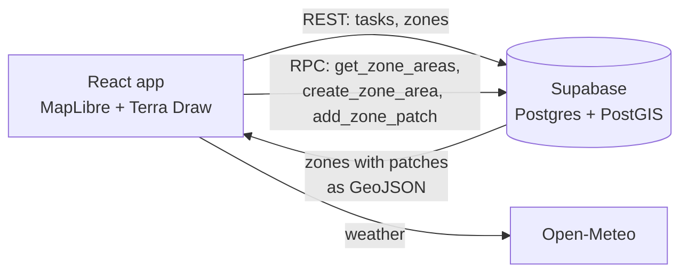

# Calvin Grounds

A map-based maintenance tracker for a campus grounds crew. Draw areas of the grounds on satellite imagery, attach recurring work to them (mowing, weeding, inspections), and see at a glance what is open, what is overdue and when each area was last looked after.

Built for the grounds of Calvin University in Grand Rapids, Michigan.

## What it does

| | |
|---|---|
| **Map** | Esri satellite imagery limited to the campus, with every zone drawn as a color-coded polygon (lawn, garden, natural reserve, path, wooded, other). A zone can be made of several separate patches. |
| **Draw** | Click "Add zone", place points on the map, close the shape, then name it. Patches can be added to or removed from an existing zone. |
| **Tasks** | Each task has a category, a priority from 1 (urgent) to 5 (optional), an optional due date and an optional repeat interval. Completing a recurring task schedules the next one automatically. |
| **At a glance** | Open and overdue counts with the local time and weather (Open-Meteo), and for each zone the last time every kind of work was done, flagged when it is overdue. |
| **Bulk work** | The zone directory lets you select several zones and give them the same task in one step, and edit names, types and notes. |



## How it is built

- **Geometry lives in PostGIS.** Polygons are stored as `geometry(Polygon, 4326)` with a spatial index, and three SQL functions convert between PostGIS and the GeoJSON the map draws, so the client never handles WKB.
- **Zones and patches are separate tables,** so one named zone can cover disconnected pieces of ground without duplicating its tasks.
- **Tasks reference an entity type and id** rather than a zone directly, leaving room for tasks on other things (trees, irrigation heads) later.
- **No backend server.** The React app talks to Supabase directly; all business rules that need atomicity (creating a zone together with its first polygon) are SQL functions.

## Running it

Requires Node.js 20+ and a free [Supabase](https://supabase.com) project.

1. In the Supabase SQL editor, run [`supabase/schema.sql`](supabase/schema.sql). It enables PostGIS and creates the tables, functions and access policies.
2. Configure and start the app:

```bash
cd app
cp .env.example .env    # set VITE_SUPABASE_URL and VITE_SUPABASE_ANON_KEY
npm install
npm run dev
```

Without the two variables the app shows these setup steps instead of the map.

> **Access.** The app has no sign-in, and the included policies let anyone with the project URL and anon key read and edit data. That suits a small trusted crew on a private deployment. Add Supabase Auth and restrict the policies to signed-in users before putting it on the open internet.

## Project layout

```
supabase/schema.sql          tables, PostGIS functions, access policies
app/src/App.jsx              data loading and view state
app/src/components/
  Map.jsx                    MapLibre map, zone layers, Terra Draw drawing
  ZoneAreaPanel.jsx          zone details, patches, tasks, last activity
  TaskList.jsx               all open tasks and history
  ZoneDirectory.jsx          zone list, editing, bulk task creation
  AddTaskForm.jsx, SaveZoneModal.jsx, MapOverlay.jsx
```

## Tech stack

React 19, Vite 8, MapLibre GL JS 6, Terra Draw, Supabase (Postgres, PostGIS), Open-Meteo.

## Roadmap

- Crew accounts with Supabase Auth, and a record of who completed each task
- Area of each zone from PostGIS, to estimate mowing time
- A phone layout for checking off work in the field
